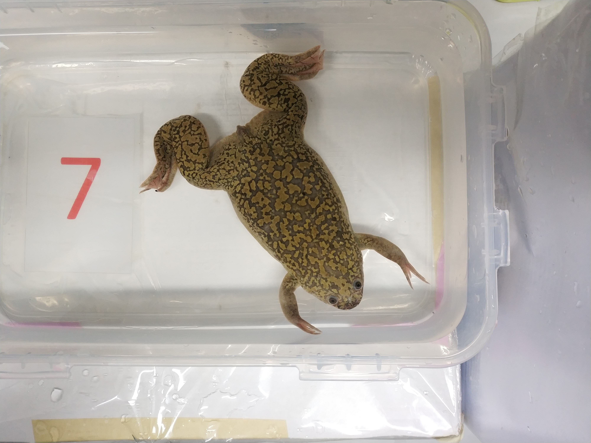
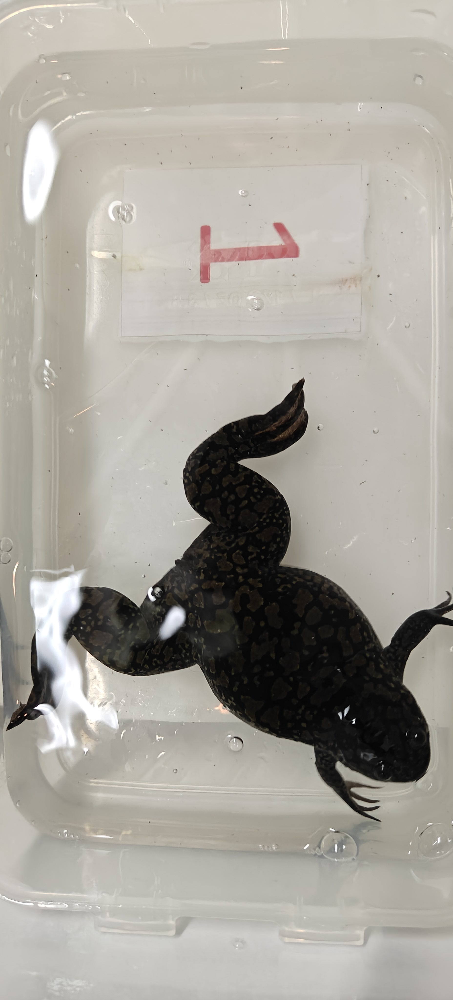

# XIBBIT – Frog Biometric Identification and Management System

XIBBIT is a web application for managing *Xenopus laevis* colonies and identifying individual frogs from photographs of their dorsal pattern. Each facility (organization) gets its own recognition model, trained on its own animals.

[](https://doi.org/10.5281/zenodo.19552230)

- **Hosted instance:** https://frog.web.rug.nl (see [Using the hosted instance](#using-the-hosted-instance))
- **Licence:** [MIT](LICENSE)

## Contents

- [Features](#features)
- [Using the hosted instance](#using-the-hosted-instance)
- [Running your own instance](#running-your-own-instance)
  - [Requirements](#requirements)
  - [Installation](#installation)
  - [Configuration](#configuration)
  - [First steps after installation](#first-steps-after-installation)
- [Training a recognition model for your facility](#training-a-recognition-model-for-your-facility)
- [Project structure](#project-structure)
- [Citing XIBBIT](#citing-xibbit)
- [Contributing and maintenance](#contributing-and-maintenance)

## Features

- Organizations, tanks and frogs with per-user access control
- Upload of reference images per frog
- Identification of a frog from a new photograph using the organization's recognition model
- Admin dashboard for managing users, organizations and recognition models
- Track system parameters of the tanks such as pH, temperature etc.

## Using the hosted instance

The University of Groningen hosts an instance at https://frog.web.rug.nl that other laboratories can use.

- **Registration:** Anyone can create an account on the site. A new account can't see or do anything until it is added to an organization.
- **Creating an organization:** Only accounts that the system administrator has given permission can create organizations. To get this permission, email one of the maintainers below with your name, your institution and the account you registered.
- **Where data is stored:** All data is stored on University of Groningen infrastructure in the Netherlands:
  - Users, organizations, frogs, tanks and system parameters are stored in a PostgreSQL database on the university's Kubernetes cluster.
  - Frog images, profile photos and organization logos are stored in the university's S3 object storage.
- **Maintained by:** the Kamenz lab at the University of Groningen. Contacts:
  - Dario Tomanin, d.tomanin@rug.nl
  - Julia Kamenz, j.kamenz@rug.nl
  - Serban Tonie, tonieserban@yahoo.ro

If you need full control over your data or want to customise the system, run your own instance as described below.

## Running your own instance

### Requirements

**Software**

| Component | Version |
|---|---|
| Docker Engine | any recent |
| Docker Compose | v2 |
| Git | any recent |

All other dependencies run inside the containers:

| Component | Version |
|---|---|
| Python (backend) | 3.8 |
| TensorFlow (CPU) | 2.13.1 |
| FastAPI | 0.103.2 |
| Node.js (frontend build) | 18 |
| React | 18 |
| PostgreSQL | 14.11 |

Full dependency lists: [backend/requirements.txt](backend/requirements.txt) and [frontend/package.json](frontend/package.json) / [frontend/package-lock.json](frontend/package-lock.json).

**Hardware**

Identification uses CPU-only TensorFlow, so the application doesn't need a GPU. Recommended:

- **CPU:** Intel Core i5 or equivalent, or better
- **RAM:** 8 GB or more

Training a model has extra requirements, including MATLAB; see [Training a recognition model](#training-a-recognition-model-for-your-facility).

**External services**

- **S3-compatible object storage** (required). Reference images, uploads and recognition models are stored there. Any S3-compatible service works (AWS S3, a university object store, or a self-hosted [MinIO](https://min.io/)).
- **Google OAuth client ID** (optional). Used for "Sign in with Google" in the frontend.

### Installation

1. Clone the repository:
   ```bash
   git clone https://github.com/Serbbi/frogtastic.git
   cd frogtastic
   ```
2. Create the configuration files from the templates:
   ```bash
   cp .env.template .env
   cp frontend/.env.template frontend/.env
   ```
3. Fill in both `.env` files (see [Configuration](#configuration)).
4. Start the stack:
   ```bash
   docker compose -f docker-compose.dev.yml up --build
   ```
5. Open the services:
   - Frontend: http://localhost:3000
   - Backend API: http://localhost:8000 (interactive API docs at http://localhost:8000/docs)
   - pgAdmin: http://localhost:8080


### Configuration

**`.env` (root)**

| Variable | Description |
|---|---|
| `DATABASE_URL` | SQLAlchemy connection string, e.g. `postgresql+psycopg2://<user>:<password>@database:5432/<db>`. Use `database` as host when running with Docker Compose. |
| `SECRET_KEY` | Secret used to sign login tokens. Generate one with `openssl rand -hex 32`. |
| `ALGORITHM` | JWT signing algorithm. Use `HS256`. |
| `ACCESS_TOKEN_EXPIRE_MINUTES` | How long a login stays valid, e.g. `30`. |
| `INITIAL_ADMIN_CREDS` | `<username>:<bcrypt hash>` of the first admin account, created on startup if it does not exist yet. See below. |
| `S3_ENDPOINT_URL` | URL of your S3-compatible storage. |
| `S3_ACCESS_KEY_ID` / `S3_SECRET_ACCESS_KEY` | S3 credentials. |
| `S3_REGION_NAME` | S3 region. |
| `S3_BUCKET_NAME` | Bucket for images and models. It must already exist. |
| `S3_ENVIRONMENT` | Optional prefix inside the bucket (default `dev`), so several instances can share one bucket. |
| `POSTGRES_USER` / `POSTGRES_PASSWORD` | Credentials for the Postgres container. They must match `DATABASE_URL`. |
| `PGADMIN_DEFAULT_EMAIL` / `PGADMIN_DEFAULT_PASSWORD` | Login for pgAdmin. |
| `REACT_APP_BACKEND_URL` | URL the frontend uses to reach the API, e.g. `http://localhost:8000/api`. |

**`frontend/.env`**

| Variable | Description |
|---|---|
| `REACT_APP_BACKEND_URL` | Same as above. |
| `REACT_APP_GOOGLE_CLIENT_ID` | OAuth client ID from the [Google Cloud console](https://console.cloud.google.com/apis/credentials). |

**Creating the admin password hash**

The password in `INITIAL_ADMIN_CREDS` must be a bcrypt hash, not plain text:

```bash
docker run --rm python:3.8-slim sh -c \
  "pip install -q 'passlib[bcrypt]' && python -c \"from passlib.hash import bcrypt; print(bcrypt.hash('YOUR_PASSWORD'))\""
```

Put the result in `.env` in single quotes so Docker Compose does not treat the `$` characters as variables:

```
INITIAL_ADMIN_CREDS='admin:$2b$12$...'
```

### First steps after installation

1. Open the frontend and sign up for a normal user account. You will use this account for daily work.
2. Log in with the admin account from `INITIAL_ADMIN_CREDS`. In the admin dashboard, give your new account permission to create organizations, then log out.
3. Log in with your new account and create an organization for your facility.
4. In the organization, add tanks and frogs, set up any extra frog attributes and table columns you need, and upload a reference image for each frog.
5. Train a recognition model (see the next section) and upload it to the organization. Until a model is uploaded, the organization can't identify frogs from photos.

## Training a recognition model for your facility

Each facility needs its own model, trained on photos of its own frogs. Training is the most involved part of setting up XIBBIT. The code is in [backend/CORF3D_ACF](backend/CORF3D_ACF) and is based on [CORF3D_HCR](https://github.com/ameybhole/CORF3D_HCR).

Training has five steps: take photos, name them, extract the dorsal pattern, train the model, and upload it.

### Requirements

- **MATLAB R2022b** with the [MATLAB Engine API for Python](https://www.mathworks.com/help/matlab/matlab_external/install-the-matlab-engine-for-python.html). The training script needs it even when you only train on RGB images.
- A Python environment with the packages in [backend/CORF3D_ACF/requirements.txt](backend/CORF3D_ACF/requirements.txt). Use a Python version that the MATLAB R2022b engine supports.

### 1. Take photos

- Take about **10 photos per frog**. Between photos, move the frog slightly. If you can, use more than one camera or phone, so the model doesn't learn the quirks of a single device.
- Photograph the frog's back (dorsal side), with the frog in the centre of the image.
- Make sure the photos are sharp and have no reflections on the skin.
- Extraction works best at a resolution of 3000×4000 pixels.

| Good | Bad |
|---|---|
|  |  |
| Frog seen from directly above, in the centre of the image, sharp and evenly lit. The whole dorsal pattern is visible. | Reflections on the lid cover part of the leg and body, and the frog is off-centre near the edge of the box. |

### 2. Name the files

The training code reads each frog's identity from the file name, so every photo must be named like this:

```
<anything>_frog<number>_tank<number>_<anything>.jpg
```

For example `221205_frog4_tank9_phone1.jpg`. The second and third parts of the name (split on `_`) are the label. Each frog and tank number must match a frog in your XIBBIT organization, because the application uses them to look up the frog it predicted.

Put all the photos in one folder, without subfolders.

### 3. Extract the dorsal pattern

The extraction script crops the patterned region from each photo and normalises it:

```bash
cd backend/CORF3D_ACF
python extraction.py "<folder with photos>" "<folder for extractions>"
```

The script saves one `.png` file per photo in the output folder. It prints the photos it couldn't process; retake those or leave them out.

### 4. Train the model

```bash
python main.py --dataset-rgb "<folder for extractions>" --output-directory output \
  --model mobilenet --resize 224 --num-epochs 12 --batch-size 10 --learning-rate 0.0005
```

- `--resize` must be `224`, because the application resizes photos to 224×224 before identification.
- The number of frogs is taken from the file names, so you don't need to set it.
- `--num-epochs`, `--batch-size` and `--learning-rate` are starting values that worked for us. Adjust them for your dataset. If training accuracy keeps rising while test accuracy stays flat or drops, the model is overfitting; train for fewer epochs.

Training uses 5-fold cross-validation, so it produces five models. When it finishes, you have:

- `output/models_new/RGB_1.h5` … `RGB_5.h5`: one trained model per fold
- `output/plots/`: accuracy and loss plots for each fold
- `labeler_new.pkl` in the current folder: the label encoder, which maps model outputs back to `frog<N>_tank<M>`

Pick the fold with the best test accuracy.

### 5. Upload the model

The application expects a model as two files that share a name: `<name>.h5` (the model) and `<name>.pkl` (the label encoder). Rename the files you picked, for example:

```bash
cp output/models_new/RGB_3.h5 my-facility-2026.h5
cp labeler_new.pkl my-facility-2026.pkl
```

Then upload both to your organization. You need an account with permission to add ML models (the initial admin account has it). Either:

- open the API docs at http://localhost:8000/docs, click **Authorize** and log in, then use `POST /ml-models/upload`, or
- use curl:

  ```bash
  # Log in and get a token
  curl -X POST http://localhost:8000/token -d "username=<username>&password=<password>"

  # Upload the model, using the access_token from the previous response
  curl -X POST "http://localhost:8000/ml-models/upload?org_q=<organization_id>" \
    -H "Authorization: Bearer <access_token>" \
    -F "model_file=@my-facility-2026.h5" \
    -F "labeler_file=@my-facility-2026.pkl"
  ```

## Project structure

```
backend/            FastAPI application
  CORF3D_ACF/       model training code
  crud/             logic behind each endpoint (file names match the API subpaths)
  models/           SQLAlchemy database models
  routers/          API endpoints
  schemas/          request/response schemas
  util/             permissions, authentication and other helpers
frontend/           React application
  src/components/   reusable and layout components
  src/hooks/        custom hooks, mostly for fetching data
  src/pages/        one directory per page
  src/services/     API client and providers
  src/util/         icons, input validation, etc.
db/init.sql         initial database schema
docs/               maintainer documentation
```

## Citing XIBBIT

If you use XIBBIT, please cite the source code archived on Zenodo:

> Tonie, S., Tomanin, D., & Kamenz, J. (2026). *XIBBIT: A biometric recognition tool for efficient Xenopus laevis identification and colony management - Source Code* [Computer software]. Zenodo. https://doi.org/10.5281/zenodo.19552231

Citation metadata is also available in [CITATION.cff](CITATION.cff), and GitHub's "Cite this repository" button uses it. To cite a specific release, use that version's DOI from the [Zenodo record](https://doi.org/10.5281/zenodo.19552230). The concept DOI `10.5281/zenodo.19552230` always resolves to the latest version.

## Contributing and maintenance

Notes for maintainers of the hosted instance (deployment, database access, known limitations and ideas for improvement) are in [docs/MAINTAINERS.md](docs/MAINTAINERS.md).

Forks, issues and pull requests are welcome.
